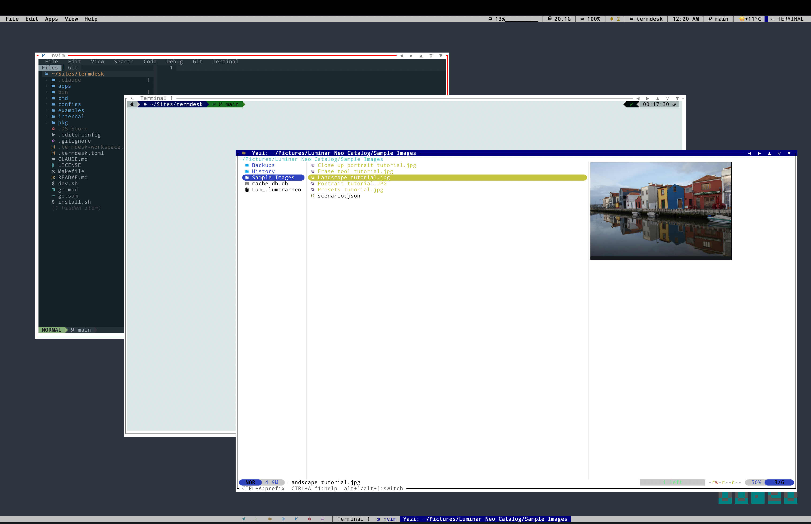
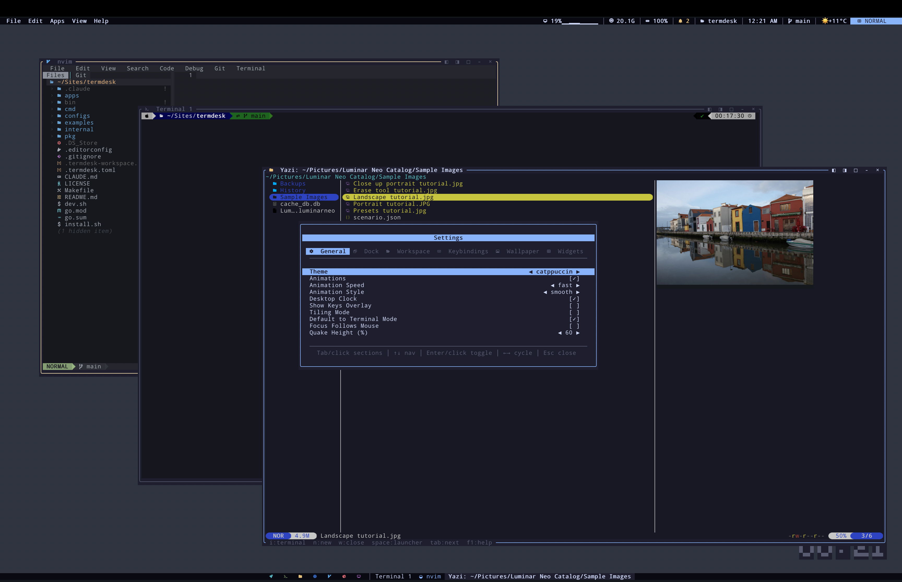

# Termdesk

A retro-flavoured desktop environment that runs inside a single terminal.
Overlapping windows, a menu bar, a dock, a command palette, themes, and real
shells running inside PTY windows. Built in Go on top of
[Bubble Tea v2](https://github.com/charmbracelet/bubbletea).

Inspired by Windows 1.0, DESQview and System 1 — but with modern niceties:
tmux-style sessions, sixel/kitty image passthrough, spring-physics animations
and a handful of built-in games.

> **Status: personal project.** I build this for myself, in my spare time.
> It's stable enough that I use it daily, but there is no support, no roadmap,
> and no promise of backward compatibility. Use at your own risk. Bug reports
> and patches are welcome but may sit for a while.

## Screenshots





## Quick start

```bash
git clone https://github.com/icex/termdesk.git
cd termdesk
./install.sh          # builds, installs, optionally pulls dependencies
termdesk
```

If you prefer to build manually:

```bash
go build -o bin/termdesk ./cmd/termdesk
./bin/termdesk
```

### Requirements

- Go 1.25+
- A terminal with truecolor and mouse support
- A Nerd Font (for dock icons)
- Recommended extras: `htop`, `yazi`, `nvim`, `python3`

### Platforms

| Platform | Status |
|---|---|
| Linux | first-class |
| macOS | works; `install.sh` handles dependencies |
| Android / Termux | works; build with `GOOS=android go build …` (not `go run`) |

## What's in the box

**Windowing**

- Overlapping windows with drag, resize, snap (left/right/top/bottom),
  maximize, tile, cascade and minimize
- Tmux-style split panes inside a window, draggable dividers
- Expose mode with animated thumbnails
- Spring-physics animations on open/close/snap/tile/minimize
- Persistent tiling mode (`columns`, `rows`, `tile all`) with live menu indicator

**Terminals**

- PTY windows running real shells and TUI apps
- VT100/ANSI emulation via `charmbracelet/x/vt`
- Keyboard and mouse forwarding — apps that enable mouse mode get events directly
- Vim-style copy mode with search, word/paragraph motions and stable snapshot scrolling
- Click-drag text selection (tmux-style)
- Image passthrough: sixel, iTerm2 inline images and the kitty graphics protocol
  (direct transmission; filesystem/shared-memory transports are rejected)
- Hold-open on exit — terminal stays open after the process exits; `r` restarts, `q` closes

**Sessions**

- tmux-like detach / reattach over a Unix socket
- Per-project named sessions (`termdesk ~/project`)
- Workspace auto-save every 60 seconds; layout and terminal buffers restored on attach

**UI**

- Menu bar with dropdowns and live widgets (CPU / memory / battery / clock / …)
- Custom shell-based widgets with `onClick` actions
- Dock with launcher shortcuts + a running-windows list
- Command palette (`Ctrl+Space`) with fuzzy search over apps and `$PATH`
- Right-click context menus, tooltips on hover
- Clipboard with a 5-slot ring buffer and history overlay
- Notifications (toasts + a notification center)
- Settings panel with 6 tabs, quake terminal (`Ctrl+` backtick), wallpapers (solid / pattern / live program), 15 built-in themes + user-defined themes
- Games: Minesweeper, Snake, Solitaire, Blockdrop

## Configuration

Config lives at `~/.config/termdesk/config.toml`:

```toml
theme = "modern"              # see View menu for the full list
animations = true
minimize_to_dock = true
tiling_mode = false
tiling_layout = "columns"     # columns | rows | all
quake_height_percent = 40

enabled_widgets = "cpu,mem,battery,notification,workspace,clock,user"

[keybindings]
prefix = "ctrl+a"             # like tmux

[[custom_widgets]]
name     = "git"
label    = "Git Branch"
icon     = "󰊢"
command  = "git rev-parse --abbrev-ref HEAD 2>/dev/null || echo '-'"
interval = 10
onClick  = "lazygit"
```

### Custom themes

Drop a TOML file in `~/.config/termdesk/themes/<name>.toml` and set
`theme = "<name>"` in `config.toml`. Fields map to the `Theme` struct in
[`internal/config/theme.go`](internal/config/theme.go); unknown keys are
ignored and any missing field falls back to a sensible default. A file whose
name matches a built-in (e.g. `modern.toml`) overrides that built-in.

```toml
# ~/.config/termdesk/themes/sunset.toml
border_top_left     = "╭"
border_top_right    = "╮"
border_bottom_left  = "╰"
border_bottom_right = "╯"
border_horizontal   = "─"
border_vertical     = "│"

content_bg        = "#1A1B26"
active_border_fg  = "#FF9E64"
active_title_fg   = "#C0CAF5"
menu_bar_bg       = "#16161E"
dock_bg           = "#16161E"
dock_accent_bg    = "#292E42"
desktop_bg        = "#1A1B26"

accent_color  = "#FF9E64"
accent_fg     = "#1A1B26"
subtle_fg     = "#565F89"
button_yes_bg = "#9ECE6A"
button_no_bg  = "#F7768E"
button_fg     = "#1A1B26"

close_button = " × "
min_button   = " - "
max_button   = " □ "

title_bar_height = 1
unfocused_fade   = 0.35

# Optional: override the terminal-content ANSI palette (ansi0..ansi15)
ansi0 = "#414868"
ansi1 = "#F7768E"
```

Reload by restarting termdesk or picking the theme from the View menu.
The fastest way to author one is to copy a bundled theme out of
[`internal/config/`](internal/config/) (e.g. `theme_modern.go`) and translate
it to TOML — the field names match one-to-one (snake_case also works).

Per-project behaviour goes in a `.termdesk.toml` at the project root:

```toml
[[autostart]]
command = "npm"
args    = ["run", "dev"]
title   = "Dev Server"

[[autostart]]
command = "nvim"
args    = ["."]
title   = "Editor"

[[dock]]
name       = "Notepad"
icon       = "󱞁"
icon_color = "#E5C07B"
command    = "nano"
position   = 2
```

`termdesk ~/myproject` opens the directory and creates a session whose name
includes a hash of the canonical path, so projects with equal directory names
remain separate. Its workspace saves there even without `.termdesk.toml`.

Project auto-start and restored workspace commands require approval for the
exact file contents. Inspect the commands first, then approve the files:

```bash
termdesk trust ~/myproject                 # config and project workspace
termdesk trust ~/.config/termdesk/workspace.toml
```

Files saved by Termdesk are approved automatically. Existing or copied workspace
files need approval before their commands run. Editing or replacing an approved
file invalidates its approval. Reopen the project/workspace after approving it.
An unapproved workspace is preserved rather than overwritten by auto-save.

Workspace files and terminal buffers use private permissions and atomic writes.
Buffer cleanup is scoped to each workspace; legacy shared buffers remain
readable and are retained so other saved workspaces keep their history.
Workspace capture does not send editor keystrokes or write modified documents.
Vim/Neovim keep their own swap/undo recovery; save documents explicitly.

Kitty clients must use direct transmission. Filesystem and shared-memory image
requests cannot be authenticated from terminal output, including output from SSH,
and are rejected. Clients that negotiate transports can fall back to direct mode.

## Sessions

```bash
termdesk                  # start or attach the default session
termdesk ~/project        # open a project directory (named session)
termdesk new work         # create a named session
termdesk ls               # list sessions
termdesk attach work      # reattach
termdesk kill work        # kill
termdesk trust ~/project  # approve inspected project/workspace commands
```

Press `F12` (or **File → Detach**) to detach. The session keeps running.

## Keybindings

### Normal mode (window management)

| Key | Action |
|---|---|
| `q` | Quit |
| `i` / `Enter` | Enter Terminal mode |
| `n` / `Ctrl+N` | New terminal window |
| `w` / `Ctrl+W` | Close focused window |
| `m` | Minimize |
| `r` | Rename (or restart an exited window) |
| `c` | Enter Copy mode |
| `Space` / `Ctrl+Space` | Launcher |
| `Tab` / `Shift+Tab` | Cycle windows → dock → menu bar |
| `h` / `l` | Snap left / right |
| `k` / `j` | Maximize / restore |
| `Alt+←/→` | Shrink / grow width |
| `Alt+↑/↓` | Shrink / grow height |
| `t` | Tile all |
| `F6` | Toggle auto-tiling (columns / rows / all) |
| `Alt+H/J/K/L` | Swap focused window left/down/up/right |
| `x` | Expose |
| `f` / `a` / `v` | File / Apps / View menu |
| `y` | Clipboard history |
| `b` | Notification center |
| `1`–`9` | Focus window N |
| `Ctrl+S` | Save workspace |
| `Ctrl+O` | Load workspace |
| `F1` | Help |

### Terminal mode (prefix system)

In Terminal mode, every key goes to the running program. The **prefix key**
(`Ctrl+A` by default) gates window-manager actions, like tmux.

| Key | Action |
|---|---|
| `Ctrl+A` | Activate prefix (status badge lights up) |
| `Ctrl+A` then *anything above* | Run a Normal-mode action |
| `Ctrl+A` `Esc` | Drop to Normal mode |
| `Ctrl+A` `Ctrl+A` | Send a literal `Ctrl+A` |
| `Ctrl+A` `c` | Copy mode |
| `Shift+Insert` / `Ctrl+Shift+V` | Paste text from the host clipboard |
| `Ctrl+A` `]` | Paste the latest Termdesk clipboard entry |
| `Ctrl+A` `y` | Clipboard history |
| `Ctrl+A` `d` | Detach session |
| `Ctrl+A` `%` / `"` | Split pane horizontal / vertical |
| `Ctrl+A` `x` | Close focused pane |
| `Ctrl+A` arrows / `Tab` | Navigate panes |
| `` Ctrl+` `` | Toggle quake terminal |
| `F2` | Escape hatch back to Normal mode |

Text copied by a child app through OSC 52 (for example, Claude Code or
Neovim's OSC 52 provider) is saved in Termdesk's clipboard history and forwarded
to the connecting terminal. Split escape sequences are supported across PTY/SSH
reads. Vim/Neovim must use an OSC 52 clipboard provider to copy to a remote host.
Child OSC 52 read queries are relayed to the outer terminal; its reply goes
back to the requesting editor, with saved text as the timeout fallback.

On Linux, Codex's visible drag selections are also mirrored through Termdesk's
terminal clipboard route. This covers locally-created sessions later attached
over SSH, where Codex can otherwise report "Copied to host clipboard" while
updating only the server's desktop clipboard. Codex keeps its native mouse
selection; Vim visual selections retain their normal editor behavior. In iTerm2,
Option-drag uses iTerm2's own local selection instead of sending mouse events.

The Edit menu shows the Paste shortcut, configurable as `paste` in
`[keybindings]`. Explicit Paste requests the outer terminal's text clipboard;
when clipboard reads are unsupported or disabled, it falls back after one
second to the latest Termdesk entry. `Ctrl+A` `]` pastes that entry immediately.
Your terminal's native Paste command (`Cmd+V` on macOS, typically
`Ctrl+Shift+V` elsewhere) sends clipboard text directly without a read query.
Native pastes also update Termdesk's history. `Ctrl+V` is passed to the child
unchanged, preserving Vim visual block mode and agent image-paste commands.

Host clipboard access depends on the outer terminal's OSC 52 support and
permissions. Terminals without it can still use native text paste and Termdesk's
internal copy/history/paste. If an emulator maps `Ctrl+Shift+V` to plain `Ctrl+V`,
use its native Paste command, `Shift+Insert`, or `Ctrl+A` `]`; the two control
keys are indistinguishable on the wire. OSC 52 transfers text; transferring local
clipboard images over SSH requires a separate file/image transport.

### Copy mode (vim-style)

| Key | Action |
|---|---|
| `j` / `k`, `PgUp` / `PgDn` | Scroll |
| `g` / `G` | Top / bottom |
| `w` / `b` / `e` | Word motions |
| `^` / `$` | Line start (indent) / end |
| `{` / `}` | Paragraph |
| `%` | Matching bracket |
| `/` / `?` | Search forward / backward |
| `n` / `N` | Next / previous match |
| `v` | Toggle selection |
| `y` / `Enter` | Yank |
| `Y` / `A` | Copy line / append to clipboard |
| `Esc` / `q` | Exit |

## Mouse

- Click a title bar to focus; drag it to move
- Drag borders/corners to resize
- Click title-bar buttons (close / maximize / minimize)
- Click a dock shortcut to launch (or focus an existing window)
- Click an empty-handed area of the dock to pick up the window list
- Click `CPU` / `MEM` widgets to open `htop`, click the clock for a date popup
- Click-drag inside a terminal to start a selection (enters copy mode)
- Scroll wheel enters copy mode on scrollback; scrolling back to the bottom exits

## Layout

```
cmd/termdesk/       entry point + session bootstrap
internal/
  app/              root model, rendering, animations
  config/           TOML config, themes, keybindings
  workspace/        workspace save/restore
  window/           windows, manager, hit testing, tiling, splits
  terminal/         PTY, VT emulation, image passthrough
  menubar/ dock/ launcher/ clipboard/ notification/
  session/          dtach-style client/server
  settings/ widget/ appmanifest/ contextmenu/ tour/ help/
pkg/
  geometry/ ringbuf/
apps/
  calc/ minesweeper/ snake/ solitaire/ blockdrop/
```

See [`CLAUDE.md`](CLAUDE.md) for development notes and gotchas.

Review regression checks:

```bash
go test -race ./...
go vet ./...
python3 scripts/test-e2e.py
python3 scripts/test-clipboard-e2e.py
```

The end-to-end script builds a temporary binary and uses its own config, trust,
buffers, sockets, and controlling PTYs. It never connects to existing sessions.
The clipboard suite also starts a private loopback sshd and checks the installed
Codex, Claude Code, Vim, and Neovim clients. It requires `ssh`, `sshd`,
`ssh-keygen`, and those four applications. Its Claude Copy test uses a local API
response fixture with dummy credentials; no paid model is called. Pass
`--binary /path/to/termdesk` to check an installed build.
`python3 scripts/test-codex-copy-e2e.py` additionally checks native Codex drag-copy
after a real SSH reattach to a local-origin session with a working desktop
clipboard. It requires `Xvfb`, `xauth`, and `xclip`, and uses an authenticated
private display. An extracted Xvfb binary can be passed with `--xvfb PATH`.
Golden render tests compare fixtures by default; update them deliberately with
`go test ./internal/app -run '^TestGolden' -update`.

## License

[MIT](LICENSE) — see the file for the full text.
